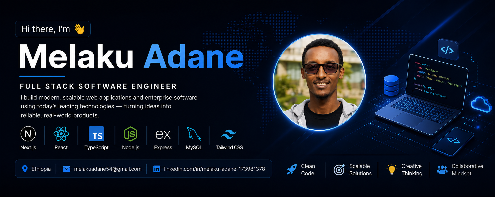

  

<h1 align="center">Hi there, I'm Melaku Adane</h1>
<h3 align="center">Full Stack Software Engineer</h3>

I build modern, scalable web applications and enterprise software with Next.js, React and Node.js.

---

<h2> About Me</h2>

 Full Stack Software Engineer 
 Based in Addis Ababa, Ethiopia 
 Building enterprise web applications 
 Learning system design and cloud technologies 
 Open to collaboration 
 Focused on clean code and scalable architecture

---

<h2> Tech Stack</h2>

  

---

<h2> Featured Projects</h2>

<h3> Damot Union</h3>
A digital platform for a farmers' cooperative union that streamlines their day-to-day operations.

<h3> Kewakibt Enterprise Platform</h3>
An enterprise management platform built with Next.js to help organizations run more efficiently.

<h3> <a href="https://github.com/melaku2402/swoms">SWOMS</a></h3>
A Staff Workload and Overload Management System that helps organizations track and balance staff workloads fairly.

---

<h2> Connect With Me</h2>

  
  

Thanks for visiting my profile!

